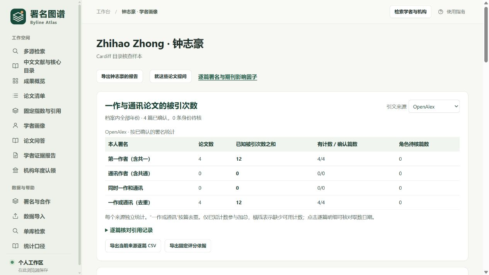
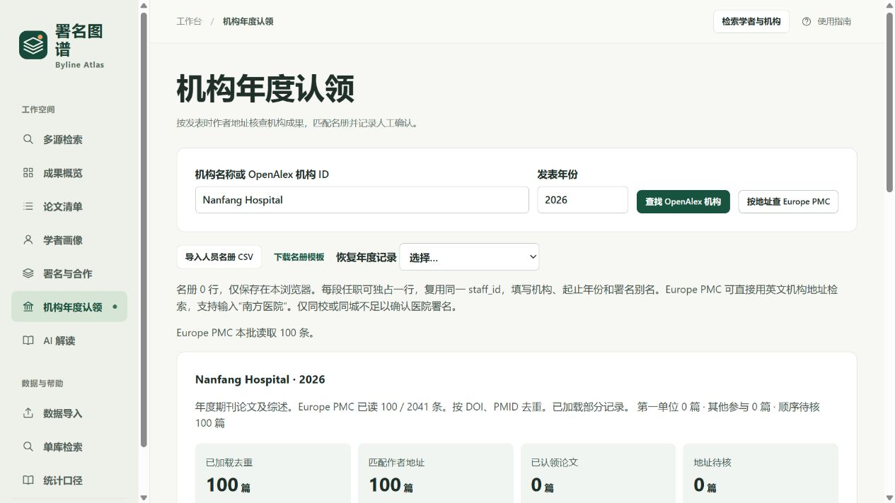

# 署名图谱 · Byline Atlas

进入[公开工作台](https://nature-q.github.io/byline-atlas/)。可直接查看[钟志豪的论文署名卡](https://nature-q.github.io/byline-atlas/zhong.html)及[学者画像](https://nature-q.github.io/byline-atlas/#zhong)。

## 使用

[打开云端账号版](https://byline-atlas-cn-r8m4.funcord8.chatgpt.site/#ai)，选择服务端通义千问或 DeepSeek 后可以登录并使用个人 API Key。公开站的免费 Qwen 在设备上运行。两个入口各自在浏览器保存工作区。

1. 从 Google Scholar 主页、主页 ID、已保存的主页 HTML 或导出的书目开始。HTML 可保留网页上实际显示的逐篇引用数。在保存之前用“显示更多”展开要导入的记录。登录云端账号版后可使用个人 SerpApi Key 分页读取公开主页，也可使用自建代理。[配置 Scholar 服务](server/scholar-relay/README.md)
2. 用姓名、ORCID、曾用单位或来源作者标识补查 OpenAlex、Crossref、Europe PMC、DBLP 及 Semantic Scholar。读取范围、身份冲突、未读取的分页按库显示。核实同一人的多个作者档案后可合并。
3. 核对待确认记录后打开画像。单位轨迹按论文关联到本人的署名地址和发表年呈现。指标注明计算规则、证据和缺失项。手动权重仅作用于个人工作区。论文列表支持影响因子、JCR 和历史中科院分区筛选。年度影响因子 CSV 的列为 issn,year,jif,source，year 为指标年。
4. 在机构年度认领中选择机构、年份，导入有权使用的人员名册，在待核队列内核对实际署名、确认或撤回认领并导出年度 CSV。人员名册和认领记录保存在本浏览器。
5. “中文文献与核心目录”提供知网检索及 RefWorks、EndNote、RIS、CSV 导入。论文身份、一作、通讯、南核来源／扩展、北大中文核心和 SSCI 均有各自的证据或目录版本，可导入适用的完整目录。
6. “固定指数与引用”列出各署名组的逐库引用。固定指数 v1.0 的一作、通讯、按论文年龄折算的 OpenAlex 引用和五年发表活跃度权重分别为 30%、20%、35% 和 15%。在“学者证据报告”可打印 PDF，并保存本地统计快照以复核下次新增或移出的论文。
7. “论文问答”在用户确认后才生成回答。支持免费浏览器本地 Qwen、个人 Qwen 或 DeepSeek API、带登录的自托管模型服务。用户可自由选择是否附上档案书目。[运行 AI 本机服务或对接账号后端](server/ai-relay/README.md)

## 机构查询示例

[打开南方医院 2026 年度检索](https://nature-q.github.io/byline-atlas/?org=Nanfang%20Hospital&year=2026&source=epmc#claims)。下图记录 2026 年 11 月 20 日首批 100 条结果。页面会随着数据库更新，人员认领数取决于所在浏览器中的核查记录。

## 部署与扩展

仓库根目录可直接部署在支持 HTTPS 的静态主机。开发时可在该目录运行 `python -m http.server 8080`。默认公开工作台无需登录。浏览器的本地工作区之间独立，用于协作认领的中心数据库、人员权限、审计留存和支付需部署服务端。

| 模块 | 职责 |
|---|---|
| federation.js、search-v3.js | 作者候选、分来源分批读取、跨库去重、证据冲突及人工核查 |
| retrieval.js、biomedical.js、evidence-v3.js | OpenAlex 与 Europe PMC 的逐作者元数据、地址及主题证据 |
| profile-v3.js、contributions.js | 署名单位轨迹、研究方向、合作指标与五项评价维度 |
| claims-v3.js | 机构年度工作台、名册匹配、认领审计与导出 |
| scholar-live.js、server/scholar-relay | 通过已有配额读取 Google Scholar 公开作者主页 |
| ai-v3.js、server/ai-relay | AI 证据包、逐篇引用、用量显示及账号接口 |
| imports.js、journal-imports.js、zhong.js | 书目导入、年度期刊数据、自带核查样本 |

当前个人原型使用公开数据接口。若运营收费产品，ORCID 要求另行安排适用的数据来源或会员接口。部署前可在 federation.js 载入前指定 `window.AtlasFederationConfig = {publicOrcidEnabled: false}` 来关闭 ORCID Public API。JIF、JCR 和历史中科院分区的全表展示与分发也需使用具备相应权限的数据。[ORCID Public API 使用说明](https://info.orcid.org/documentation/integration-guide/registering-a-public-api-client/)
